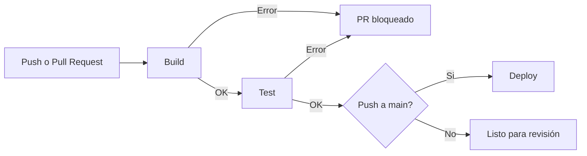

# PilarBus

Ecosistema móvil de transporte público para la ciudad de Pilar.


PilarBus es una aplicación móvil y plataforma web desarrollada en conjunto por la Municipalidad de Pilar y la Universidad Nacional de Pilar. Su objetivo es que los ciudadanos puedan ver el recorrido de los colectivos en tiempo real.

Trabajo práctico para la materia Fundamentos del Desarrollo del Software y Metodologías Ágiles (UNPilar, 2026).

## Metodología

El proyecto se gestiona con Scrum porque los requisitos no están cerrados desde el principio y van cambiando según el feedback semanal de los usuarios beta. Trabajamos en sprints de una a dos semanas, y al final de cada uno hay una versión funcionando que se puede probar.

El esfuerzo de cada tarea se estima en Story Points mediante Planning Poker, usando la escala de Fibonacci (1, 2, 3, 5, 8, 13). Las estimaciones se revisan en cada sprint según la velocidad real del equipo, por lo que se adaptan a los cambios de requisitos sin tener que rehacer toda la planificación.

## Product Backlog

Cada fila corresponde a una tarjeta del [tablero de Trello](https://trello.com/b/sxszQVsW/pilarbus). El estado se actualiza a medida que las tarjetas avanzan en el tablero.

| Tarea | Descripción | Story Points | Roles | Estado |
|---|---|---|---|---|
| Sistema de reclamos | Reportes de pasajeros con seguimiento del estado | 5 | Backend, Mobile, Tester | Hecho |
| Registro e inicio de sesión | Creación de cuenta y acceso de usuarios | 5 | Backend, Mobile, Tester | Por hacer |
| CI/CD | Pipeline de build, test y deploy automático | 3 | DevOps, Scrum Master | Por hacer |
| Mapa con colectivos en tiempo real | Ubicación de cada colectivo en el mapa | 13 | Backend, Mobile, Tester | Por hacer |
| Búsqueda de líneas y paradas | Consulta de recorridos y paradas | 5 | Backend, Mobile | Por hacer |
| Alertas de desvíos | Avisos ante cortes, obras o cambios de recorrido | 8 | Backend, Mobile, Tester | Por hacer |
| Plataforma web | Versión web de la aplicación | 8 | Frontend, Tester | Por hacer |
| Integración con SUBE | Consulta de saldo y últimos viajes | 13 | Backend, Tester | Por hacer |
| **Total** | | **60** | | |

Las tareas de 13 puntos (mapa en tiempo real e integración con SUBE) son las de mayor incertidumbre. Antes de entrar a un sprint se dividen en historias más chicas.

### Subtareas

Cada tarjeta de Trello tiene un checklist con sus subtareas:

- **Sistema de reclamos:** formulario de reclamo, guardar el reclamo, seguimiento del estado.
- **Registro e inicio de sesión:** pantalla de registro, login con mail, recuperar contraseña, tests.
- **CI/CD:** workflow de GitHub Actions, protección de la rama `main`, deploy automático, README.
- **Mapa con colectivos en tiempo real:** recibir la posición GPS de los colectivos, mostrar el mapa, actualizar posiciones, tests.
- **Búsqueda de líneas y paradas:** buscador, listado de paradas, mostrar el recorrido de la línea.
- **Alertas de desvíos:** carga de desvíos, notificación push, mostrar el desvío en el mapa, tests.
- **Plataforma web:** página del mapa, búsqueda de líneas, diseño responsive, tests.
- **Integración con SUBE:** conexión con la API de SUBE, consulta de saldo, últimos viajes, tests.

## Tablero Kanban

El tablero de Trello tiene tres columnas:

| Columna | Significado |
|---|---|
| Por hacer | Tareas del backlog que todavía no se empezaron |
| En proceso | Tareas en las que alguien está trabajando |
| Hecho | Tareas terminadas y probadas |

La columna "En proceso" tiene un límite WIP (Work In Progress) de 3 tareas. Mientras haya 3 tareas en curso, nadie empieza una nueva hasta terminar alguna. Esto evita que se acumule trabajo a medio hacer y hace que los bloqueos se vean enseguida, porque una tarea trabada frena al resto del equipo y obliga a resolverla.

Cada tarjeta tiene su estimación en Story Points, etiquetas con los roles involucrados, un checklist de subtareas y los responsables asignados.

## Flujo de trabajo con Pull Requests

No se sube código directamente a `main`. Todo cambio entra a través de un Pull Request.

1. Se crea una rama a partir de `main`. Usamos los prefijos `feature/` para funcionalidades nuevas, `fix/` para correcciones y `docs/` para documentación (por ejemplo `feature/alertas-desvios`).
2. Se hacen los commits en esa rama.
3. Se abre un Pull Request hacia `main` con una descripción del cambio y el link a la tarjeta de Trello correspondiente.
4. GitHub Actions ejecuta automáticamente el build y los tests sobre el PR.
5. Al menos otro integrante del equipo revisa el código y lo aprueba.
6. Se hace el merge solamente si el pipeline pasó y el PR fue aprobado.

Cuando se abre el PR, la tarjeta pasa a "En proceso". Cuando se mergea, pasa a "Hecho".

De esta forma ningún cambio llega a `main` sin compilar y sin pasar los tests, cada cambio queda registrado con su revisión, y `main` se mantiene siempre en un estado que se puede desplegar.

## CI/CD

El pipeline está definido en [`.github/workflows/ci.yml`](.github/workflows/ci.yml) y se ejecuta con GitHub Actions.



### Cuándo se ejecuta

| Evento | Etapas |
|---|---|
| Pull Request hacia `main` | Build y Test |
| Push o merge a `main` | Build, Test y Deploy |

### Etapas

| Job | Descripción | Depende de |
|---|---|---|
| `build` | Descarga el código, configura Node 20, instala dependencias y ejecuta `npm run build`. | - |
| `test` | Ejecuta las pruebas automatizadas con `npm test`. | `build` |
| `deploy` | Publica la nueva versión en la nube. Solo se ejecuta en `main`. | `build`, `test` |

### Integración continua

Cada vez que se integra código, el pipeline verifica que el proyecto compile y que los tests pasen. Si alguna etapa falla, el PR queda marcado como fallido y no se mergea hasta corregirlo. Así los errores se detectan apenas se introducen y no cuando ya se acumularon varios cambios.

### Entrega continua

Cuando un cambio se mergea a `main` y pasa el build y los tests, el job de deploy lo publica en producción sin intervención manual. Esto permite que las mejoras pedidas por los usuarios beta lleguen a la aplicación en poco tiempo.

Nota: por ahora los scripts de build, test y deploy son simulados. La estructura del pipeline es la misma que se usaría con el código real.

### Deploy sin interrupciones

Como la aplicación se usa mientras la gente espera el colectivo, no puede quedar fuera de servicio durante una actualización. Para eso el deploy usa la estrategia de rolling update: se levantan instancias con la versión nueva y se van reemplazando las viejas de a una, de manera que siempre haya alguna atendiendo usuarios. Si la nueva versión presenta problemas, se vuelve a la anterior.

## Estructura del repositorio

```
Pilar-bus/
├── .github/
│   └── workflows/
│       └── ci.yml
├── .gitignore
├── LICENSE
├── package.json
└── README.md
```

## Ejecución local

Requiere Node.js 20 o superior.

```bash
git clone https://github.com/Musimundoo/Pilar-bus.git
cd Pilar-bus
npm install
npm run build
npm test
```

## Equipo

| Integrante | Rol |
|---|---|
| faltaria esto muchachos | Scrum Master |
| faltaria esto muchachos | Product Owner |
| faltaria esto muchachos | Desarrollador |
| faltaria esto muchachos | Tester |

Tablero de Trello: [PilarBus en Trello](https://trello.com/b/sxszQVsW/pilarbus)

## Licencia

MIT. Ver [LICENSE](LICENSE).
